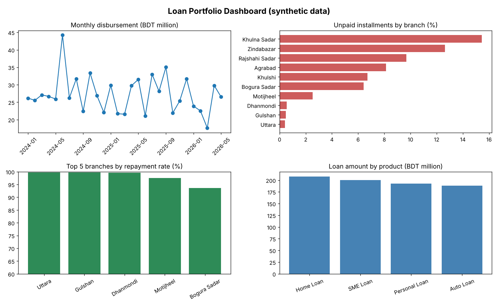
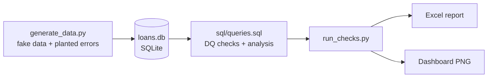

# Loan Portfolio Data Quality and Dashboard

A small end-to-end data project that imitates work done in a finance
technology team: build a database, check its data quality with SQL,
automate the checks with Python, and present the results in a dashboard.

**All data is synthetic (fake). No real customer data is used.**



## Problem
A lender's loan database often contains errors such as duplicate customers,
missing IDs, impossible payments and orphan records. These errors lead to wrong
reports. This project finds them automatically and summarises the portfolio.

## What it does
1. Generates a fake loan database (SQLite): 10 branches, 515 customers, 760 loans, 12,000+ installments
2. Plants 7 types of data errors on purpose
3. Runs 7 SQL data-quality checks that find them
4. Runs 5 business queries (overdue ratio, monthly disbursement, repayment rate, top loans per branch, running total) using JOINs, GROUP BY, CASE and window functions
5. Exports an Excel report and a 4-chart dashboard image

## Data flow


## How to run
```bash
pip install -r requirements.txt
python generate_data.py
python run_checks.py
```
Outputs appear in the `output/` folder.

## Results
All 7 checks found exactly the number of errors that were planted
(see docs/test_cases.md).

| Check | Issues found |
|---|---|
| Missing NID | 12 |
| Duplicate NID | 15 |
| Invalid phone | 10 |
| Invalid principal | 8 |
| Orphan loans | 6 |
| Payment before disbursement | 10 |
| Overpayment | 10 |

## Project structure
```
generate_data.py      create the fake database
run_checks.py         run SQL, export Excel and dashboard
sql/schema.sql        table definitions
sql/queries.sql       all SQL checks and analysis
docs/                 data dictionary and test cases
output/               report and dashboard
```

## Tools
Python, SQL (SQLite), pandas, matplotlib, openpyxl, Git

## Possible next steps
- Move the database to MySQL or PostgreSQL
- Build the dashboard in Power BI
- Add a star-schema data warehouse layer
- Schedule the checks to run daily
